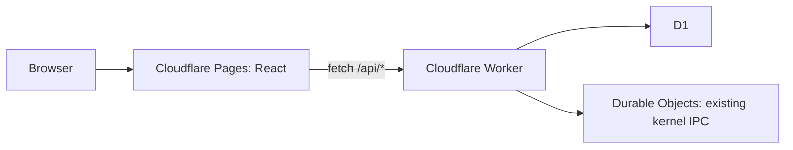

# Pages and Worker boundary

ICVS lives in `icvs/index.ts`; MAX-CORE is an integration boundary awaiting its actual implementation. No external orchestrator, scheduler, ingestion, recovery engine, or publication action is introduced by this dashboard. Approval decisions record governor intent; they do not publish products automatically.

## API

All responses are JSON. New endpoints return 404 for unknown routes or IDs, 405 for unsupported methods, and generic 500 errors if storage fails. Legacy `/api/kernel/*` response bodies and root status are preserved. All routes, including kernel and health, now share the configured origin allowlist instead of wildcard kernel CORS. The existing recovery and ICVS ingestion URLs in the Dart client are still placeholders in the kernel and are not implemented by this change.

| Endpoint                          | Response                                                                     |
| --------------------------------- | ---------------------------------------------------------------------------- |
| `GET /api/dashboard`              | `{ projects, activeProducts, readyToPublish, approvals, health }`            |
| `GET /api/products`               | Array of products                                                            |
| `GET /api/products/:id`           | One product, or 404                                                          |
| `GET /api/portfolio`              | Products ranked by score, highest first                                      |
| `GET /api/pipeline`               | Array of `{ stage, products }` covering all six stages                       |
| `GET /api/approvals`              | Pending `{ id, productId, project, action, priority, risk, status }` records |
| `POST /api/approvals/:id/approve` | `{ success: true, status: "approved" }`                                      |
| `POST /api/approvals/:id/reject`  | `{ success: true, status: "rejected" }`                                      |
| `GET /api/analytics`              | `{ stage, count, averageScore }[]`                                           |
| `GET /api/telemetry`              | `{ state, count }[]` from virtual processes                                  |
| `GET /api/governance`             | `{ status, count }[]` from approval history                                  |

Product fields: `id`, `name`, `description`, `stage`, `score` (0–100), and `updatedAt` (SQLite UTC timestamp). Stages: Idea, Validation, Build, Ready, Live, Archived. Active products means Live; ready to publish means Ready. Process health is the rounded percentage of READY, RUNNING, and SUSPENDED processes among all stored processes. It is `null` when there are none. This measures stored process states, not a live heartbeat or infrastructure SLA.

Decision requests require `Authorization: Bearer <GOVERNOR_API_TOKEN>`. Missing server configuration returns 503; invalid authorization returns 401. Decisions atomically update only pending requests; a second decision returns 409, a nonexistent ID returns 404. Changes persist in D1. SQL values are parameterized. The API does not accept arbitrary product edits.

All Worker routes allow browser origins listed in comma-separated `ALLOWED_ORIGINS`. The configured defaults include localhost, 127.0.0.1, and `https://portal-os1.pages.dev`. Configure exact scheme/host/port values. Allowed OPTIONS requests return 204 with GET, POST, PUT, PATCH, DELETE, OPTIONS and Content-Type/Authorization permissions. CORS advertises credential support with an exact allowed origin; route handlers still determine supported methods. All responses, including errors, vary by Origin. Disallowed browser origins receive 403. CORS is not authentication; non-browser clients can access public read routes. API responses use `Cache-Control: no-store`.

## Cloudflare deployment

1. Confirm the existing D1 database ID and Durable Object namespace in `wrangler.toml` belong to the intended account. The `v1` actor migration and class name are preserved. Do not recreate them for an existing deployment.
2. Add the exact deployed Pages/custom origins to `ALLOWED_ORIGINS` in `wrangler.toml`. Add individual preview origins when needed; wildcard subdomains are not interpreted.
3. Apply migrations with `npx wrangler d1 migrations apply DB --remote`. Migration 0001 uses the existing kernel schema with `IF NOT EXISTS`; 0002 adds products and approvals. Existing kernel rows remain intact. Do not run the demo seed remotely.
4. Set the Worker secret with `npx wrangler secret put GOVERNOR_API_TOKEN` and deploy with `npm run deploy:worker`.
5. Create a Cloudflare Pages project connected to this monorepo. Set root directory to the repository root, build command `npm ci && npm run build`, output directory `apps/pages/dist`, and Node version 24 (or 22.12+).
6. Set **Pages build variable** `VITE_API_URL=https://portal-os1.maxjurreau.workers.dev` for production and the intended API origin for previews. Rebuild after changing it. If omitted, production builds default to this Worker URL; local development defaults to localhost:8787. No secrets belong in Pages `VITE_` variables.
7. Alternatively run `npm run deploy:pages` after authenticating Wrangler and configuring the build variable in the local build environment. Pages' default SPA fallback handles direct links; no top-level `404.html` is emitted.
8. Populate real product and approval data through trusted backend integrations. Empty production tables display empty states. The optional seed is synthetic local data only.

The pre-existing workflow under `github/workflows/` is not an active GitHub Actions path. This implementation documents explicit deployment commands rather than enabling automatic production deployment. Run type checks, tests and build before deployment. Cloudflare pricing and account quotas must be checked against actual usage; this structure cannot guarantee a zero-dollar bill.
